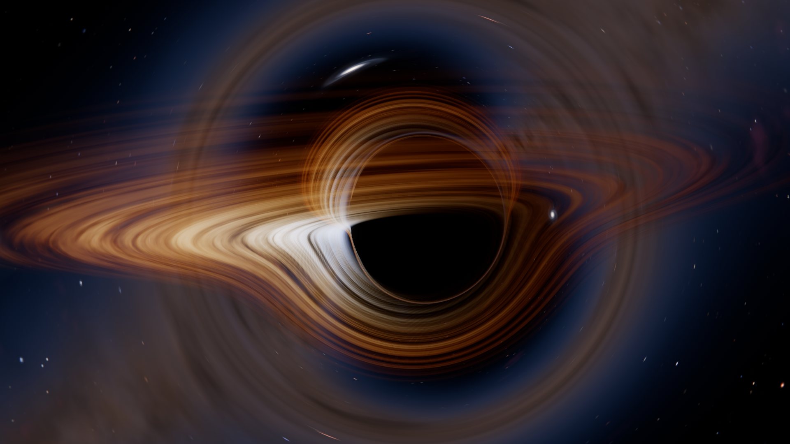
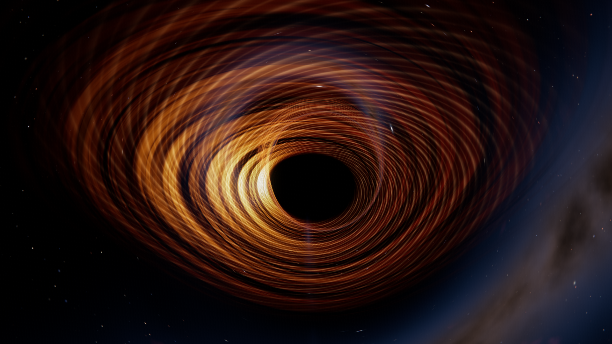
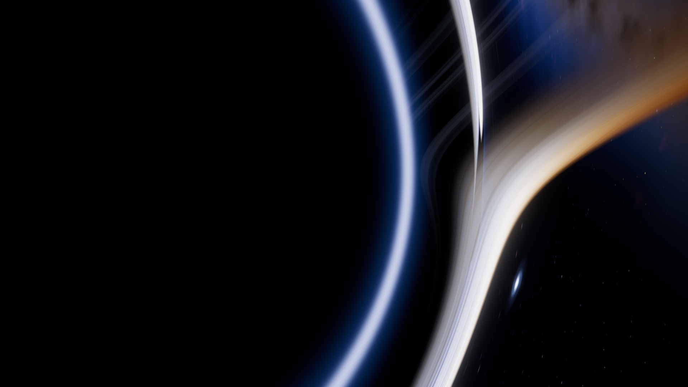
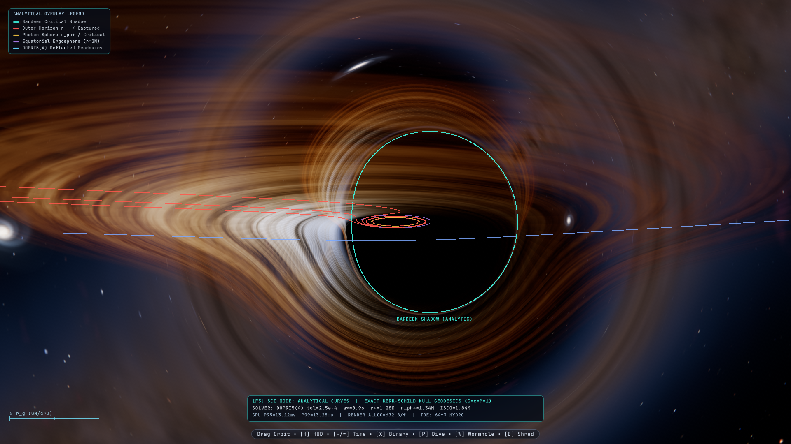

<div align="center">

# BlackHole

**Real-Time General-Relativistic Kerr-Schild Black Hole, Binary Merger, Morris-Thorne Wormhole & Compute TDE Engine**

[](https://adoptium.net/)
[](https://www.khronos.org/opengl/)
[](https://www.lwjgl.org/)
[](https://github.com/LaithAbuzaid/BlackHole/actions)
[](https://github.com/LaithAbuzaid/BlackHole/releases/latest)
[](LICENSE)

*Exact Cartesian Kerr-Schild RK4 & Adaptive DOPRI5(4) Geodesics · Analytic Bardeen Shadow Diagnostics · Binary Black Hole Merger & LIGO GW Chirp · Morris-Thorne Wormhole · 64³ GPU Grid-Hydro & Boris Lense-Thirring Compute TDE · Relativistic HDR TAA · JetBrains Mono MTSDF HUD*

</div>

---

<!--
  SHOWCASE VIDEO PLACEHOLDER:
  Drag and drop a 1080p .mp4 clip into a GitHub Issue or PR editor to generate a GitHub-hosted
  https://github.com/user-attachments/assets/... video URL, then paste that URL on its own line
  directly below this comment to render an auto-playing inline showcase player above the hero still.
-->
<p align="center">
  
  <br>
  <sub><b>Kerr-Schild Spacetime (<i>a<sub>*</sub></i> = 0.96)</b> — Asymmetric frame-dragged shadow, Doppler-beamed accretion disk, lensed photon ring (<i>n</i> &ge; 1), and horizontal anamorphic glare rendered in real time at 1080p.</sub>
</p>

## Visual Showcase

<p align="center">
  
  <br>
  <sub><b>Binary Black Hole Merger &amp; Gravitational Waves (`[X]`)</b> — Superposed boosted Kerr–Schild geodesics, mutual secondary "eyebrow" shadow lensing, companion mini-disks, shock-heated tidal gas bridge, and propagating quadrupole gravitational waves (<i>h<sub>+</sub></i>, <i>h<sub>&times;</sub></i>) with live LIGO chirp audio.</sub>
</p>

<table>
  <tr>
    <td align="center" width="50%">
      
      <br>
      <sub><b>Interactive TDE Lab (`[E]` / `[Shift+E]` / `[F5]`)</b> — 64³ GPU Eulerian–Lagrangian grid hydrodynamics + energy-preserving Boris Lense–Thirring precession across 4 stellar archetypes.</sub>
    </td>
    <td align="center" width="50%">
      
      <br>
      <sub><b>Morris–Thorne Wormhole (`[W]`)</b> — Exact <i>Interstellar</i> Dneg metric linking two GPU-baked 1024²×6 HDR cubemap universes across <i>l</i> = 0 with camera-invariant sheet continuation.</sub>
    </td>
  </tr>
  <tr>
    <td align="center" width="50%">
      
      <br>
      <sub><b>EHT 230 GHz Polarized Magnetic Fields (`[N]` / `[Shift+N]`)</b> — Kerr-dragged synchrotron polarization swirl rendered in authentic 1.3 mm VLBI brightness temperature.</sub>
    </td>
    <td align="center" width="50%">
      
      <br>
      <sub><b>Observatory HUD &amp; Timelapse Dock (`[H]`)</b> — 3-state HUD cycle, 4-tab console (<code>SCENE | PHYSICS | TDE LAB | OPTICS</code>), bottom timelapse dock, and live 6-pass GPU timers.</sub>
    </td>
  </tr>
  <tr>
    <td align="center" width="50%">
      
      <br>
      <sub><b>Horizon Plunge (`[P]`)</b> — Exact <i>L<sub>z</sub></i> = 0 Doran free-fall tetrad inside <i>r<sub>+</sub></i> looking back at the aberrated Cauchy/Einstein ring and blueshifted accretion disk.</sub>
    </td>
    <td align="center" width="50%">
      
      <br>
      <sub><b>Scientific Diagnostics (`[F3]` / `[F4]`)</b> — Live analytic Bardeen shadow curve, concentric <i>r<sub>+</sub></i>/<i>r<sub>ph+</sub></i>/<i>r<sub>ergo</sub></i> rings, adaptive DOPRI5(4) equatorial geodesics, and Hamiltonian conservation telemetry.</sub>
    </td>
  </tr>
</table>

---

## First-Impression Experience

- **Cinema First, Console Second:** Launches unobstructed in full-screen Cinema Mode with a **Director's Cut Attract Tour** (`[T]`) sweeping from an edge-on Kerr reveal through an automated 65,536-particle Tidal Disruption pass down to the photon ring.
- **Instant Zero-Jump Handoff:** Clicking, dragging, scrolling, or pressing any camera/mode key immediately hands off control from the tour with zero camera discontinuity.
- **Zero-Dependency 1080p Snapshots (`[F12]`):** Pure-Java PNG encoder (`util/PngWriter.java`, no `java.desktop`/AWT bloat) captures clean HUD-free frames asynchronously to `captures/` with subtle toast confirmations.

---

## Physics & Rendering Architecture

| Subsystem | Implementation Highlights |
|---|---|
| **Kerr–Schild RK4 & DOPRI5(4)** | Exact Cartesian spheroidal radius $r$, analytic metric gradients ($\nabla r, \nabla H, \nabla(\mathbf{l}\cdot\mathbf{p})$), and dual GPU null geodesic solvers (`[F4]`): register-lean VGPR-RK4 and adaptive 5th-order Dormand–Prince **DOPRI5(4)** conserving $\mathcal{H} = \frac{1}{2}g^{\mu\nu}p_\mu p_\nu = 0$. Exact $r_+ = M + \sqrt{M^2 - a^2}$, Bardeen–Press–Teukolsky prograde ISCO, cubic Hermite equatorial crossings ($n = 0, 1, \ge 2$), 128³ baked periodic 3D disk turbulence, and covariant Doppler beaming + Planck blackbody LUT. |
| **Scientific Diagnostics (`[F3]`)** | Live `[F3]` mode cycle (`OFF` → `HAMILTONIAN ERROR` → `STEP DENSITY` → `ANALYTICAL OVERLAY`) rendering per-pixel $\log_{10}|\mathcal{H}|$ conservation heatmaps, adaptive step-count maps, and an analytic finite-distance **Bardeen critical shadow** overlay with concentric $r_+$, $r_{\text{ph}+}$, $r_{\text{ergo}}$ contours and live DOPRI5(4) equatorial geodesic trajectories. |
| **Binary Black Hole Merger (`[X]`)** | Deterministic Peters–Mathews inspiral ($\frac{da}{dt} = -\frac{64}{5}\frac{\eta M^3}{a^3}$), coalescence, and $(l=2,m=2)$ QNM ringdown forming a spinning Kerr remnant ($a_f \approx 3.464\eta - 2.9\eta^2$). Ray-traced via superposed Lorentz-boosted Kerr–Schild geodesics (`binary_merger.frag`) with mutual secondary "eyebrow" shadow lensing, $m=2$ circumbinary disk, companion mini-disks, shock-heated tidal bridge, retarded quadrupole $h_+, h_\times$ skybox deflection + `[G]` orbital-plane ripple overlay, MRT `GL_RG16F` TAA motion vectors, live LIGO chirp audio, and a 160-sample HUD strain oscilloscope. |
| **Doran Horizon Plunge** | Exact $L_z = 0$ horizon-penetrating Kerr–Schild / Doran free-fall observer tetrad (`[P]` / `[F]`) crossing $r_+$ cleanly ($\beta_{\text{in}} = c$ at $r_+$) with independent 360° free-look, proper time ($\tau$) vs. diverging coordinate time ($t_\infty \to \infty$), relativistic blueshift, Kerr inner Cauchy horizon ($r_-$) mass-inflation flash, Schwarzschild anisotropic optical spaghettification, and tidal camera micro-rumble. |
| **Morris–Thorne Wormhole** | Exact *Interstellar* / Dneg embedding radius $r(l)$ with live throat radius $\rho$, throat half-length $a$, and lensing width $M_w$. Smooth bidirectional flight across $l = 0$ between GPU-baked `1024×1024×6` mipmapped HDR cubemaps (**Universe A**: Milky Way; **Universe B**: teal-amber nebula & ringed gas giant) with camera-invariant sheet continuation and `textureGrad` ray differentials. |
| **Global Timelapse (`-`/`=`/`0`)** | Unified `0.05×` slow-motion to `25×` timelapse across Kerr, Wormhole, Binary Merger, Horizon Plunge, and TDE without altering camera/UI wall-clock responsiveness. Single-dispatch in-shader substeps preserve 100% simulated time at `25×`, while TAA dynamically raises its blend floor above `4×` and OpenAL compresses pitch logarithmically. |
| **Interactive Compute TDE Lab** | `65,536` particles per star (2-slot `131,072` ring-buffered SSBO) across 4 stellar archetypes (**Solar G2V**, **Red Supergiant**, **Blue O-Type**, **White Dwarf**) with live penetration factor $\beta = r_t/r_p$ (`0.6`–`4.0`) and orbital inclination (`-65°` to `+65°`). Standard Paczyński–Wiita gravity ($V = -\frac{1}{r - 2M}$) paired with exact kinetic-energy-preserving **Boris Lense–Thirring precession** and toggleable (`[F5]`) **64³ GPU Eulerian–Lagrangian grid hydrodynamics** (polytropic pressure $-\nabla P/\rho$ + stream-intersection shock viscosity) with 256-thread shared-memory atomic reductions and zero-stall ping-pong `GLsync` readbacks. |
| **Relativistic Temporal AA (TAA)** | 16-phase Halton(2,3) sub-pixel jittered 1-ray/px geodesics resolved via `taa_resolve.frag` with exact 3D camera parallax reprojection (using linear world hit distance in `hdrFbo.a`), 5-tap Catmull-Rom bicubic history sampling, and Karis-weighted 3×3 YCoCg variance clipping for flicker-free photon rings and 130+ FPS 1080p performance. |
| **Karis Bloom + Anamorphic Glare** | 5-level HDR bloom pyramid (`GL_RGBA16F`) with weight-normalized Jimenez/Karis firefly suppression and quadratic soft-knee extraction, a 2-pass cascaded 13-tap *Interstellar*-style horizontal anamorphic streak at 1/8 resolution (shadow-guarded so black levels inside $r_+$ stay pure), ACES filmic tonemapping, and post-tonemap TPDF dithering. |
| **Modular Glassmorphic HUD** | 3-state `[H]` cycle (`CLEAN` → `COMPACT` → `FULL`), frosted vertical-gradient SDF panels with top specular rims, bottom-center **Timelapse Transport Bar**, 4-tab Observatory Console (`SCENE` \| `PHYSICS` \| `TDE LAB` \| `OPTICS`) with 1-line hover tooltips, and pre-baked 3-channel MSDF + SDF JetBrains Mono Medium typography (zero `java.desktop`/AWT dependency). |
| **Procedural OpenAL Audio** | Zero-asset 44.1 kHz stereo PCM daemon synthesizer (`lwjgl-openal`) generating gravitational-redshift sub-bass drones, Doppler-panned accretion roar, TDE periapsis plasma crackle, and sweeping wormhole throat harmonics (with graceful silent fallback). |
| **Hardware `GL_TIME_ELAPSED` Profiling** | 3-slot asynchronous ring-buffered OpenGL timer queries measuring all 6 GPU passes (**Raytrace**, **TDE Compute**, **TDE Render**, **TAA**, **Post/Bloom**, **UI**) independently alongside `nvidia-smi` / `GL_NVX_gpu_memory_info` telemetry, JVM/system CPU load, and a 120-frame oscilloscope trace — all with **zero per-frame Java heap allocations**. |

---

## Measured 1080p Benchmarks (`--benchmark`)

Measured via `java --enable-native-access=ALL-UNNAMED -jar target/blackhole-2.0.0.jar --benchmark` on an **NVIDIA GeForce RTX 4060** (OpenGL `4.3.0`, driver `620.70.06`, `1920×1080`, 0 GL errors):

| Scenario | RAY (ms) | TDE_C (ms) | TDE_R (ms) | TAA (ms) | POST (ms) | UI (ms) | TOTAL (ms) | Avg FPS | P95 (ms) |
|---|---:|---:|---:|---:|---:|---:|---:|---:|---:|
| **Kerr VGPR-RK4 (`1×`)** | 6.50 | 0.00 | 0.00 | 0.50 | 0.23 | 0.00 | **7.23** | **138.3** | 7.85 |
| **Kerr DOPRI5(4) (`1×`)** | 11.37 | 0.00 | 0.00 | 0.58 | 0.23 | 0.00 | **12.18** | **82.1** | 12.41 |
| **Kerr + 65k TDE 64³ Hydro (`1×` + Full HUD)** | 6.65 | 0.56 | 0.69 | 0.32 | 0.29 | 0.02 | **8.53** | **117.3** | 8.86 |
| **Kerr + 65k TDE 64³ Hydro (`10×` Timelapse)** | 6.64 | 0.40 | 1.43 | 0.40 | 0.26 | 0.00 | **9.13** | **109.5** | 9.78 |
| **Binary Merger (`1×` + MRT TAA)** | 7.82 | 0.00 | 0.00 | 0.54 | 0.24 | 0.00 | **8.59** | **116.4** | 8.97 |

All 39 headless JUnit 5 validation tests (`mvn -B test`) verify exact Kerr–Schild metric identities, Doran interior horizon escape, Bardeen shadow extrema, DOPRI5(4) geodesic convergence, Morris–Thorne wormhole invariance, Peters–Mathews binary coalescence, and GLSL shader uniform contracts.

---

## Render Pipeline & Repository Layout

```text
  [GPU Bake Once @ Boot]
   ├─ noise_volume.frag        ──▶ 128³ R16F Mipmapped 3D Periodic Turbulence
   ├─ skybox_milkyway.frag     ──▶ 1024²×6 RGBA16F Cubemap (Universe A)
   └─ skybox_nebula.frag       ──▶ 1024²×6 RGBA16F Cubemap (Universe B)

  [Per-Frame Pipeline — Zero Heap Allocations]
   Pass 1A  kerr_blackhole.frag / binary_merger.frag (MRT + Vel) / morris_thorne_wormhole.frag ──▶ hdrFbo
   Pass 1B  tidal_hydro_splat.comp ──▶ 64³ Grid ──▶ tidal_disruption.comp ──▶ Instanced Lensed TDE (+hdrFbo)
   Pass 1C  taa_resolve.frag (3D Parallax / MRT Velocity + Catmull-Rom + Karis YCoCg) ──▶ taaFbo
   Pass 2A  5× bloom_downsample.frag (Karis) ──▶ 4× bloom_upsample.frag (Tent)
   Pass 2B  2× anamorphic_blur.frag (1/8 Res 13-Tap Horizontal Streak Cascade)
   Pass 3   tonemap_composite.frag (Bloom + Anamorphic + ACES + TPDF Dither) ──▶ Backbuffer
   Pass 4   hud.{vert,frag} (SDF Glassmorphism + JetBrains Mono MTSDF + LIGO Oscilloscope)
```

```text
src/
├── main/
│   ├── java/
│   │   ├── module-info.java
│   │   └── io/github/laithabuzaid/blackhole/
│   │       ├── Main.java                       # CLI entry (--capture-showcase, --benchmark)
│   │       ├── audio/RelativisticAudioEngine.java
│   │       ├── core/
│   │       │   ├── BinaryMergerPhysics.java    # Peters-Mathews inspiral, merger & QNM ringdown
│   │       │   ├── CameraController.java       # Orbit, Plunge, Binary, Wormhole & Attract Tour
│   │       │   ├── SimulationEngine.java       # GLFW loop, async [F12], --benchmark & --capture-showcase
│   │       │   ├── SimulationState.java
│   │       │   └── StellarArchetype.java       # 4 TDE star classes, beta periapsis & substep plan
│   │       ├── graphics/
│   │       │   ├── BenchmarkAndShowcaseRunner.java
│   │       │   ├── BlackHoleRenderer.java
│   │       │   ├── GpuTimerQueries.java
│   │       │   ├── RenderTargets.java
│   │       │   ├── ShaderProgram.java
│   │       │   └── TidalDisruptionSystem.java
│   │       ├── math/                           # KerrMetric, MorrisThorneMetric, DormandPrince54/Rk4/Symplectic integrators, PlanckBlackbody, TdeInitialConditions
│   │       ├── telemetry/HardwareTelemetry.java
│   │       ├── ui/{HudOverlay.java, ScientificVisualizer.java, UiRenderer.java}
│   │       └── util/{FramebufferCapture.java, PngWriter.java, SettingsStore.java}
│   └── resources/
│       ├── fonts/jetbrains_mono_mtsdf.bin      # Pre-baked 3-channel MSDF + SDF atlas
│       └── shaders/
│           ├── common/fullscreen.vert
│           ├── bake/{noise_volume.frag, skybox_milkyway.frag, skybox_nebula.frag}
│           ├── simulation/{kerr_blackhole.frag, binary_merger.frag, morris_thorne_wormhole.frag, tidal_hydro_splat.comp, tidal_disruption.*}
│           ├── post/{taa_resolve.frag, bloom_downsample.frag, bloom_upsample.frag, anamorphic_blur.frag, tonemap_composite.frag}
│           └── ui/{hud.vert, hud.frag}
└── test/java/io/github/laithabuzaid/blackhole/ # 39 headless JUnit 5 physics, geodesic, binary, camera & shader tests
```

---

## Download & Run (No Java Required)

Pre-built native releases (~22–24 MB with a minimal bundled `jlink` runtime) are published on the [**GitHub Releases**](https://github.com/LaithAbuzaid/BlackHole/releases/latest) page:

| Platform | Download | How to Run |
|---|---|---|
| **Windows (x64)** | `BlackHole-2.0.0-Windows-x64-Setup.exe` *(or `Portable.zip`)* | Run the installer (adds Start Menu & Desktop shortcuts), or unzip and launch `BlackHole.exe` |
| **Linux (x86_64)** | `BlackHole-2.0.0-Linux-x86_64.AppImage` *(or `.deb`)* | `chmod +x BlackHole-2.0.0-Linux-x86_64.AppImage && ./BlackHole-2.0.0-Linux-x86_64.AppImage` |

> **GPU Requirement:** OpenGL 4.3 Core (Windows 10/11 x64 or Linux x86_64). *(macOS is capped at OpenGL 4.1 by Apple and does not support OpenGL 4.3 Compute Shaders.)*

---

## Build from Source

**Prerequisites:** JDK 17+ (21+ recommended), Maven 3.8+, and an OpenGL 4.3-capable GPU driver.  
OS-specific LWJGL/OpenAL native classifiers (`natives-linux`, `natives-windows`) activate automatically via Maven profiles.

### Linux
```bash
mvn clean package
java --enable-native-access=ALL-UNNAMED -jar target/blackhole-2.0.0.jar
```

### Windows (PowerShell / CMD)
```powershell
mvn clean package
java --enable-native-access=ALL-UNNAMED -jar target\blackhole-2.0.0.jar
```

### Run Repeatable 1080p GPU Benchmark & Regenerate All 8 Showcase PNGs
```bash
java --enable-native-access=ALL-UNNAMED -jar target/blackhole-2.0.0.jar --benchmark
java --enable-native-access=ALL-UNNAMED -jar target/blackhole-2.0.0.jar --capture-showcase
```
> `--benchmark` measures all 5 1080p workloads across all 6 GPU timer passes with zero GL errors; `--capture-showcase` renders all 8 curated `1920×1080` showcase stills into `docs/media/` using an offscreen FBO and exits cleanly with status `0`.

---

## Controls

| Input | Action |
|---|---|
| **Left-Drag** | Orbit camera (instantly disengages Attract Tour) / drag console sliders |
| **Scroll Wheel** | Logarithmic zoom (Black Hole / Binary) · Fly through throat `l ∈ [-35, +35]` (Wormhole) · Plunge speed (`[P]`) |
| `H` | Cycle HUD Visibility: **Cinema Clean** → **Compact Dock** → **Full Observatory Console** |
| `-` / `=` (or `,` / `.`) / `0` | Global Physics-Safe Timelapse (`0.05×` – `25×`) · `0`: Snap to `1.0×` Realtime |
| `X` / `Shift+X` | Toggle **Binary Black Hole Merger & GW Sandbox** · `Shift+X`: Replay Merger |
| `T` | Toggle **Director's Cut Attract Tour** |
| `P` | Launch / Abort / Replay **Horizon Plunge Dive** (`r+` → Interior) |
| `W` | Switch Spacetime: **Kerr–Schild Black Hole** ↔ **Morris–Thorne Wormhole** |
| `E` / `Shift+E` / `Shift+C` | Launch Star (TDE Lab) · `Shift+E`: Cycle Stellar Archetype · `Shift+C`: Clear Debris |
| `N` / `Shift+N` | Toggle **EHT Polarized Magnetic Fields** · `Shift+N`: Toggle **EHT 230 GHz VLBI Radio Palette** |
| `Q` | Toggle **Astrophysical Scale Ruler** ($r_g$) & Shadow / Binary Tracking Reticle |
| `F3` / `F4` / `F5` | Cycle **Scientific Diagnostics** (`OFF` / `HAMILTONIAN` / `STEPS` / `ANALYTICAL`) · `F4`: Switch **RK4 / DOPRI5(4)** · `F5`: Toggle **TDE 64³ Grid Hydro** |
| `F11` / `Alt+Enter` | Toggle Borderless Fullscreen Display |
| `F12` / `S` | Capture clean HUD-free PNG screenshot (`~/Pictures/BlackHole/` or `captures/`) |
| `A` | Toggle Procedural OpenAL Soundscape (including live **LIGO Chirp** in Binary mode) |
| `1` `2` `3` `4` | Presets — Black Hole: Edge / Polar / Photon Ring / Dive · Binary: Oblique / Top-Down / Close / Replay · Wormhole: Univ A / Throat / Univ B / Fly-Through |
| `Up` / `Down` | Fly forward / backward through the wormhole throat |
| `L` `D` `J` `B` `K` | Toggle Lensing · Accretion Disk · Bipolar Jets · Doppler Beaming · Kerr Spin |
| `F` `M` `C` `I` `O` | Toggle Free-Fall Frame · Temporal AA (TAA) · Celestial Grid · Image-Order Vis · Auto Orbit |
| `U` `G` `[` `]` `V` | Toggle Camera Roll · GW Strain Overlay (Binary) / Cycle Bloom · Exposure `−`/`+` · V-Sync |
| `Space` / `R` / `Esc` | Pause · Reset Simulation · Quit |
