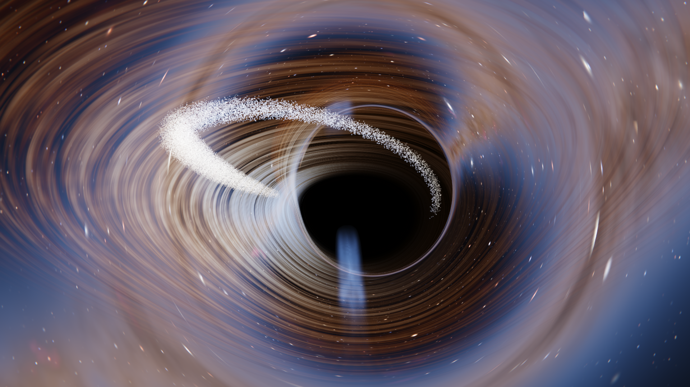

<div align="center">

# BlackHole

**Real-Time General-Relativistic Kerr-Schild Black Hole, Morris-Thorne Wormhole & Compute TDE Engine**

[](https://adoptium.net/)
[](https://www.khronos.org/opengl/)
[](https://www.lwjgl.org/)
[](https://github.com/LaithAbuzaid/BlackHole/actions/workflows/build.yml)
[](#)

*Exact Cartesian Kerr-Schild RK4 geodesics · Interstellar Morris-Thorne wormhole · 65,536-particle GPU compute TDE · Doran horizon plunge · Procedural OpenAL audio · Zero per-frame GC allocations*

</div>

---

<!--
  SHOWCASE VIDEO PLACEHOLDER:
  Drag and drop a 1080p .mp4 clip into a GitHub Issue or PR editor to generate a GitHub-hosted
  https://github.com/user-attachments/assets/... video URL, then paste that URL on its own line
  directly below this comment to render an auto-playing inline showcase player above the hero still.
-->
<p align="center">
  
  <br>
  <sub><b>Kerr-Schild Spacetime (<i>a<sub>*</sub></i> = 0.96)</b> — Asymmetric frame-dragged shadow, Doppler-beamed accretion disk, Einstein photon ring, and horizontal anamorphic glare rendered in real time at 1080p.</sub>
</p>

## Visual Showcase

<table>
  <tr>
    <td align="center" width="50%">
      
      <br>
      <sub><b>OpenGL 4.3 Compute TDE (`[E]`)</b> — 65,536-particle star sheared across periapsis under Paczyński–Wiita gravity &amp; Kerr frame-dragging torque.</sub>
    </td>
    <td align="center" width="50%">
      
      <br>
      <sub><b>Morris–Thorne Wormhole (`[W]`)</b> — Exact <i>Interstellar</i> Dneg metric linking two GPU-baked 1024²×6 HDR cubemap universes across <i>l</i> = 0.</sub>
    </td>
  </tr>
  <tr>
    <td align="center" width="50%">
      
      <br>
      <sub><b>Horizon Plunge (`[P]`)</b> — Doran / Kerr–Schild free-fall interior view (<i>r</i> &lt; <i>r<sub>+</sub></i>) looking back at the blueshifted exterior sky &amp; disk ring.</sub>
    </td>
    <td align="center" width="50%">
      
      <br>
      <sub><b>Hardware Profiler &amp; Optics Console (`[H]`)</b> — Asynchronous <code>GL_TIME_ELAPSED</code> pass timers, VRAM/thermal telemetry, and live spacetime controls.</sub>
    </td>
  </tr>
</table>

---

## First-Impression Experience

- **Cinema First, Console Second:** Launches unobstructed in full-screen Cinema Mode with a **Director's Cut Attract Tour** (`[T]`) sweeping from an edge-on Kerr reveal through an automated 65,536-particle Tidal Disruption pass down to the photon ring.
- **Instant Zero-Jump Handoff:** Clicking, dragging, scrolling, or pressing any camera/mode key immediately hands off control from the tour with zero camera discontinuity.
- **Zero-Dependency 1080p Snapshots (`[F12]`):** Pure-Java PNG encoder (`util/PngWriter.java`, no `java.desktop`/AWT bloat) captures clean HUD-free frames asynchronously to `captures/` with subtle toast confirmations.

---

## Physics & Rendering Architecture

| Subsystem | Implementation Highlights |
|---|---|
| **Kerr–Schild RK4 Hamiltonian** | Exact Cartesian spheroidal radius $r$, analytic metric gradients ($\nabla r, \nabla H, \nabla(\mathbf{l}\cdot\mathbf{p})$), and RK4 null geodesic evolution conserving $\mathcal{H} = \frac{1}{2}g^{\mu\nu}p_\mu p_\nu = 0$. Exact $r_+ = M + \sqrt{M^2 - a^2}$, Bardeen–Press–Teukolsky prograde ISCO, cubic Hermite equatorial crossings ($n = 0, 1, \ge 2$), 128³ baked periodic 3D disk turbulence, and covariant Doppler beaming + blackbody LUT. |
| **Doran Horizon Plunge** | Horizon-penetrating Kerr–Schild / Doran observer frame (`[P]` / `[F]`) crossing $r_+$ cleanly ($\beta_{\text{in}} = c$ at $r_+$) with independent 360° free-look, proper time ($\tau$) vs. diverging coordinate time ($t_\infty \to \infty$), relativistic blueshift, Kerr inner Cauchy horizon ($r_-$) mass-inflation flash, Schwarzschild anisotropic optical spaghettification, and tidal camera micro-rumble. |
| **Morris–Thorne Wormhole** | Exact *Interstellar* / Dneg embedding radius $r(l)$ with live throat radius $\rho$, throat half-length $a$, and lensing width $M_w$. Smooth bidirectional flight across $l = 0$ between GPU-baked `1024×1024×6` mipmapped HDR cubemaps (**Universe A**: Milky Way; **Universe B**: teal-amber nebula & ringed gas giant) with `textureGrad` ray differentials. |
| **OpenGL 4.3 Compute TDE** | `65,536` particles per star (2-slot `131,072` ring-buffered SSBO) stepped in `tidal_disruption.comp` with 2-substep Velocity-Verlet integration, Lense–Thirring frame-dragging torque, tidal shear shock heating, and analytical shadow-cone occlusion rendered as additive HDR sprites directly into `hdrFbo`. |
| **Karis Bloom + Anamorphic Glare** | 5-level HDR bloom pyramid (`GL_RGBA16F`) with Karis-averaged firefly suppression, a subtle 7-tap *Interstellar*-style horizontal anamorphic streak from coarse bloom mip 2 (shadow-guarded so black levels inside $r_+$ stay pure), and ACES filmic tonemapping. |
| **Procedural OpenAL Audio** | Zero-asset 44.1 kHz stereo PCM daemon synthesizer (`lwjgl-openal`) generating gravitational-redshift sub-bass drones, Doppler-panned accretion roar, TDE periapsis plasma crackle, and sweeping wormhole throat harmonics (with graceful silent fallback). |
| **Hardware `GL_TIME_ELAPSED` Profiling** | 3-slot asynchronous ring-buffered OpenGL timer queries measuring **Raytrace**, **TDE**, **Bloom**, and **UI** passes independently alongside `nvidia-smi` / `GL_NVX_gpu_memory_info` telemetry, JVM/system CPU load, and a 120-frame oscilloscope trace — all with **zero per-frame Java heap allocations**. |

---

## Render Pipeline & Repository Layout

```text
  [GPU Bake Once @ Boot]
   ├─ noise_volume.frag        ──▶ 128³ R16F 3D Periodic Turbulence
   ├─ skybox_milkyway.frag     ──▶ 1024²×6 RGBA16F Cubemap (Universe A)
   └─ skybox_nebula.frag       ──▶ 1024²×6 RGBA16F Cubemap (Universe B)

  [Per-Frame Pipeline — Zero Heap Allocations]
   Pass 1A  kerr_blackhole.frag / morris_thorne_wormhole.frag ──▶ hdrFbo (RGBA16F)
   Pass 1B  tidal_disruption.comp ──▶ SSBO ──▶ tidal_disruption.{vert,frag} (+hdrFbo)
   Pass 2   5× bloom_downsample.frag (Karis) ──▶ 4× bloom_upsample.frag (Tent)
   Pass 3   tonemap_composite.frag (Bloom + 7-Tap Anamorphic Streak + ACES) ──▶ Backbuffer
   Pass 4   hud.{vert,frag} (SDF Glassmorphism + Bitmap Telemetry + Toasts)
```

```text
src/main/
├── java/
│   ├── module-info.java
│   └── io/github/laithabuzaid/blackhole/
│       ├── Main.java                       # CLI entry (--capture-showcase)
│       ├── audio/RelativisticAudioEngine.java
│       ├── core/
│       │   ├── CameraController.java       # Orbit, Plunge, Wormhole, Attract Tour & Tidal Rumble
│       │   ├── SimulationEngine.java       # GLFW loop, async [F12] & --capture-showcase
│       │   └── SimulationState.java
│       ├── graphics/
│       │   ├── BlackHoleRenderer.java
│       │   ├── GpuTimerQueries.java
│       │   ├── RenderTargets.java
│       │   ├── ShaderProgram.java
│       │   └── TidalDisruptionSystem.java
│       ├── telemetry/HardwareTelemetry.java
│       ├── ui/{HudOverlay.java, UiRenderer.java}
│       └── util/PngWriter.java             # Pure-Java zero-dependency PNG encoder
└── resources/shaders/
    ├── common/fullscreen.vert
    ├── bake/{noise_volume.frag, skybox_milkyway.frag, skybox_nebula.frag}
    ├── simulation/{kerr_blackhole.frag, morris_thorne_wormhole.frag, tidal_disruption.*}
    ├── post/{bloom_downsample.frag, bloom_upsample.frag, tonemap_composite.frag}
    └── ui/{hud.vert, hud.frag}
```

---

## Build & Run

**Prerequisites:** JDK 21+, Maven 3.8+, and an OpenGL 4.3-capable GPU driver.  
OS-specific LWJGL/OpenAL native classifiers (`natives-linux`, `natives-windows`, `natives-macos`) activate automatically via Maven profiles.

### Linux & macOS
```bash
mvn clean package
java --enable-native-access=ALL-UNNAMED -jar target/blackhole-1.0-SNAPSHOT.jar
```

### Windows (PowerShell / CMD)
```powershell
mvn clean package
java --enable-native-access=ALL-UNNAMED -jar target\blackhole-1.0-SNAPSHOT.jar
```

### Regenerate All 5 Curated 1080p Showcase PNGs
```bash
java --enable-native-access=ALL-UNNAMED -jar target/blackhole-1.0-SNAPSHOT.jar --capture-showcase
```
> Renders all 5 `1920×1080` showcase stills into `docs/media/` using an offscreen FBO and exits cleanly with status `0`.

---

## Controls

| Input | Action |
|---|---|
| **Left-Drag** | Orbit camera (instantly disengages Attract Tour) / drag console sliders |
| **Scroll Wheel** | Logarithmic zoom (Black Hole) · Fly through throat `l ∈ [-35, +35]` (Wormhole) · Plunge speed (`[P]`) |
| `H` | Toggle Glassmorphic Console & Hardware Profiler (**Cinema Mode** ↔ **Telemetry HUD**) |
| `T` | Toggle **Director's Cut Attract Tour** |
| `P` | Launch / Abort / Replay **Horizon Plunge Dive** (`r+` → Interior) |
| `W` | Switch Spacetime: **Kerr–Schild Black Hole** ↔ **Morris–Thorne Wormhole** |
| `E` | Inject & Shred a **65,536-particle Star** (Tidal Disruption Event) |
| `F12` / `S` | Capture clean HUD-free PNG screenshot to `captures/` |
| `A` | Toggle Procedural OpenAL Soundscape |
| `1` `2` `3` `4` | Presets — Black Hole: Edge / Polar / Photon Ring / Horizon Dive · Wormhole: Univ A / Throat / Univ B / Fly-Through |
| `Up` / `Down` | Fly forward / backward through the wormhole throat |
| `L` `D` `J` `B` `K` | Toggle Lensing · Accretion Disk · Bipolar Jets · Doppler Beaming · Kerr Spin |
| `F` `M` `C` `I` `O` | Toggle Free-Fall Frame · 4× Adaptive AA · Celestial Grid · Image-Order Vis · Auto Orbit |
| `U` `G` `[` `]` `V` | Toggle Camera Roll · Cycle Bloom · Exposure `−`/`+` · V-Sync |
| `Space` / `R` / `Esc` | Pause · Reset Simulation · Quit |
